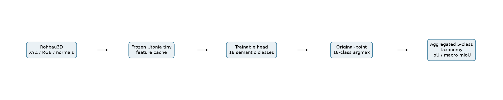
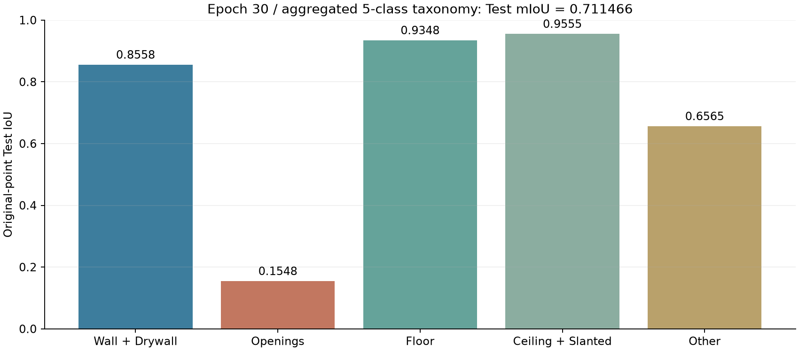
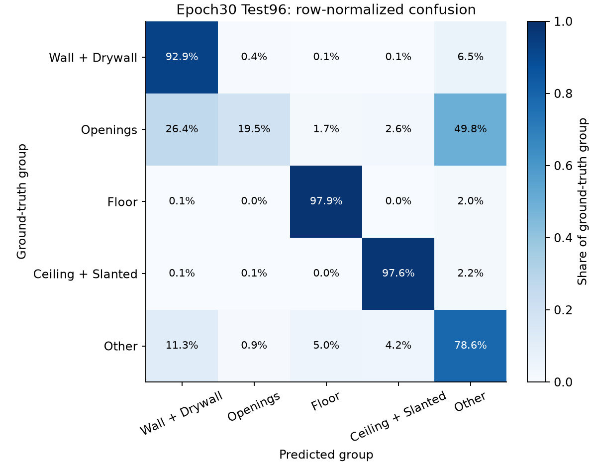
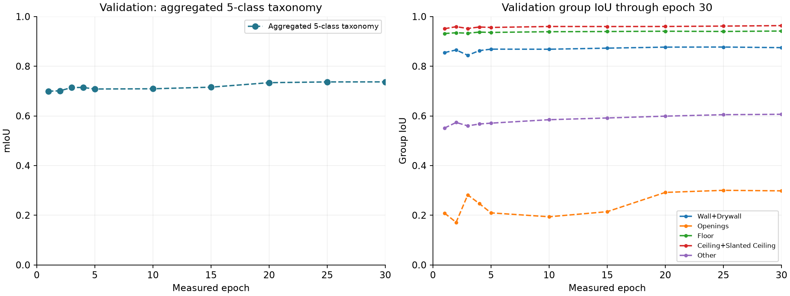

# Construction Robot Work-Surface Recognition

Semantic segmentation of construction-site point clouds to identify work surfaces and exclusion regions for **construction robots, such as plastering and painting robots**. The published model checkpoint at **epoch 30** achieves a full-test **mean Intersection over Union (mIoU) of 0.711466**, evaluated using an **aggregated 5-class taxonomy** formed by merging the dataset’s original 18 classes.

This is an offline point-cloud study, rather than a validated robot control or surface-readiness system.



## Dataset and benchmark split

We use [Rohbau3D](https://open-data.unibw.de/dataset.xhtml?persistentId=doi:10.60776/ZWJFI4), with the Dataverse 4.0 metadata snapshot used in this study. Inputs are XYZ coordinates, RGB colors, and surface normals. The model retains the original 18 semantic labels, including None. Dataset files are not redistributed.

| Split | Scenes | Purpose | Site relationship |
|---|---:|---|---|
| Train | 354 | Train the segmentation head | 12 sites |
| Validation | 54 | Observe development performance | Same 12 sites as Train; no shared scenes |
| Test | 96 | Report performance | Separate sites: site_00(36 scenes), site_08(60 scenes) |

The original benchmark scene assignments are unchanged. **Test is separated by site; Train and Validation share sites.** Exact memberships are in [data/splits.json](data/splits.json).

## Model and training

- Frozen **Utonia tiny** backbone with a trainable multi-scale 18-class segmentation head.
- Voxel size 0.02 in native coordinate units; blocks of 16,384 representative points; cached FP16 backbone features; inverse mapping to every original point.
- Training loss: **18-class CrossEntropy**. Optimizer: AdamW, learning rate 0.001, weight decay 0.01.
- **The model was not retrained with a 5-group loss.** Evaluation merges the 18-class argmax predictions and ground truth into the five groups below.
- Epoch30 was fixed as the public checkpoint by the project owner. It was not automatically selected as the best Test result. See the [recipe](configs/recipe.json).

## Final result: epoch 30 / aggregated 5-class taxonomy

Evaluation covers all **96 Test scenes and 2,294,339,698 original points**. Each IoU is calculated from the confusion matrix pooled across the complete Test split. The reported mIoU is the unweighted mean of the five group IoUs.

| Group | Original label IDs | Test IoU |
|---|---|---:|
| Wall + Drywall | 5,6 | 0.855781 |
| Openings | 12,13,3,7,14 | 0.154761 |
| Floor | 4 | 0.934807 |
| Ceiling + Slanted Ceiling | 1,2 | 0.955494 |
| Other | 0,8,9,10,11,15,16,17 | 0.656487 |
| **mIoU** | **Mean of five group IoUs** | **0.711466** |

**Openings** combines Window, Window Cutout, Ceiling Cutout, Wall Cutout, and Door Rough Opening. None belongs to Other. See the [exact mapping](configs/groups.json) and [CSV table](results/group_scores.csv).



The Openings IoU is **0.154761**. The overall mean therefore does not establish reliable recognition of robot exclusion regions.



## Validation curves through epoch 30



Markers denote measured checkpoints only. Saved Validation predictions were regrouped according to the aggregated 5-class taxonomy; this does not mean the model was trained with that grouping as its loss. These are Validation curves, not Test learning curves.

Test results had already been exposed before this user-requested additional evaluation. They should not be presented as a new, untouched final holdout. This semantic-only head does not produce instance masks or Mask AP.

## Run

From the repository root, verify the published scores on CPU:

```bash
pip install -r docs/setup/requirements-metrics.txt
python run.py verify-results
```

For actual GPU evaluation, cache generation, and explicitly requested retraining, see [Reproducibility](docs/REPRODUCIBILITY.md). Obtain the external dataset and pretrained backbone separately.

## Repository layout

```text
README.md / run.py   Overview and execution entry point
configs/            Training recipe and aggregated 5-class taxonomy definition
data/               Official scene memberships and class names
src/                Head, cache/evaluation code, and attributed Utonia source
checkpoints/        Published epoch 30 head only
results/            Test evidence, CSV tables, and figures
docs/               Setup, provenance, and third-party notices
```

[Sources and licenses](docs/THIRD_PARTY_NOTICES.md) · [Checkpoint provenance](docs/provenance/PROVENANCE.json) · [File manifest](docs/provenance/MANIFEST.json)
